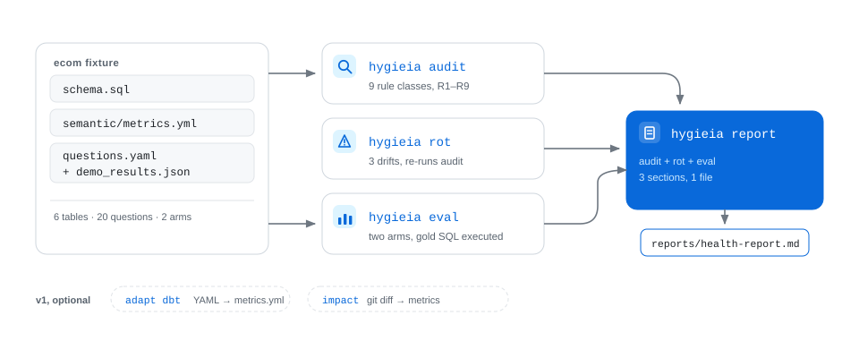

# Hygieia

> 检查已有的语义层，给出可复现的体检结果。全程本地离线运行。

🌐 **English**：[README.md](../../README.md)

Hygieia 是一个本地运行的 Python 命令行工具，用来检查已有的语义层：静态诊断（`audit`）、两臂对照评测（`eval`）、腐烂模拟（`rot`），最后写出一份 Markdown 体检报告（`report`）。它不负责建本体。语义层从哪里来都可以，Hygieia 只看它是否已经出了问题，以及 agent 会不会在这份语义层上给出错误的数字。

- Python 3.10+，运行时依赖 `pyyaml` 和 `sqlglot`（AST 级 SQL 解析）；不联网，不需要账号和 API key
- 以 coding-agent skill 的形式交付
- 编码契约见 [docs/contract.zh.md](../../docs/contract.zh.md)（中文权威版）和 [docs/contract.en.md](../../docs/contract.en.md)（英文版）

---

## 公开层级证据

在谈私有数仓之前，先在公开的中立语义层上跑：Apache Ossie 的 TPC-DS 语义模型。fixture 是 `examples/tpcds_semantic_model.yaml` 的裁剪副本，保留上游 Apache-2.0 许可证头，没有人为改动，也不需要 `schema.sql`：

```bash
hygieia adapt ossie --in fixtures/ossie_tpcds/ossie_semantic_model.yaml --out .tmp/ossie
hygieia --lang zh audit .tmp/ossie
# 🔴 高危 R1-synonym-conflict [location]：同义词「location」同时指向多个口径/字段：ss_store_sk, s_city
# 🔴 高危 R1-synonym-conflict [price]：同义词「price」同时指向多个口径/字段：ss_sales_price, i_current_price
# 🔴 高危 R1-synonym-conflict [profit]：同义词「profit」同时指向多个口径/字段：total_profit, ss_net_profit
```

这是标准作者自己发布的参考模型里的三处真实词表冲突。`audit` 同时报 4 条 R5（模型没有声明证据），并在 `skipped_rules` 里列出 `R4-dangling-ref` 与 R3 的表/列校验——样例不带 DDL，这一点被明确标注，而不是隐瞒。复现命令、日期与边界见 [docs/public-layers.md](../../docs/public-layers.md)。

## 关键数字（模拟 demo）

下面这组数字是**模拟 demo**，不是模型现场跑出来的：两臂答案由人工编写，只有 SQL 判分是真实执行。它展示的是失败模式的形状，不是对某个模型的评测结论。

数据 agent 问数时，指标、同义词、join、域和证据都来自语义层，口径只有这一处。口径一旦漂移，agent 仍会给出一个看起来正常的错误数字。ecom 示例（6 表电商，20 道中文问题）复现了这件事：两臂答案由人工编写，判分用真实 SQL 执行。

| 指标 | 无语义层 | 有语义层 |
|---|---|---|
| 准确率 | 13/20（65%） | 20/20（100%） |
| 静默错答率 | 7/20（35%） | 0/20（0%） |

静默错答指返回了数字，没有报错，也没有澄清，用户无法察觉。这是 `eval` 的核心指标。

每道题另外按两个维度判分：**entity**（表 / join 路径）与 **relation**（指标口径：聚合 + 过滤）。demo 上 control 的 entity 是 17/20、relation 是 13/20，treatment 两个维度都是 20/20：失败主要是口径错，不是找错表。`eval` 会写一份 manifest（`reports/manifest.json`），锁住模型、prompt 哈希、问题集哈希、语料哈希、语义层哈希与工具版本；这些字段不一致时 `report` 会明确提示两次 run 不可直接比较，并在「总分上升、某维度下降」时单独标红：

| 版本锁定项 | 内容 |
|---|---|
| prompt | `fixtures/ecom/prompts/{control,treatment}.md` 的 sha256 |
| 问题集 / 语料 / 语义层 | `questions.yaml`、`schema.sql`+`seed.sql`、`semantic/metrics.yml` 的 sha256 |
| model | demo 为 `simulated (hand-authored)`，live 取 `meta.json` |

对照组答错的 7 道题里，几道有代表性的：

| 题 | 问题 | 无语义层答 | 正确口径 |
|---|---|---|---|
| q07 | 上个月净收入是多少 | 1210（没扣取消单） | 1110 |
| q08 | 总收入是多少 | 1860（含取消单） | 1760 |
| q09 | 有多少活跃客户 | 6（直接数客户表） | 5（30 天内下过单） |
| q10 | 营收是多少 | 1860（走了错误口径） | 1760（net_revenue） |
| q11 | 下单转化率是多少 | 编造 0.25 | 没有访问数据，应澄清 |
| q12 | 平均客单价是多少 | 155（含取消单） | 176 |
| q20 | 净收入是否含运费 | 直接答“包含” | 未定义运费，应澄清 |

`audit` 在同一份语义层上检出 7 条问题：3 条高危（R1 同义冲突、R3 join 歧义、R4 悬空引用），4 条中危（R5 证据缺失）。`rot` 注入五类漂移（列改名、定义篡改、新增孤儿指标、别名指向废弃指标、一个指标合并两个新鲜度矛盾的来源）后重跑 `audit`，新增捕获 6 条：结构漂移 4 条（列改名带来 2 条 R4，新增孤儿指标带来 1 条高危 R2 + 1 条中危 R5），语义腐烂 2 条（stale alias、来源新鲜度冲突）。定义篡改命中的 `refund_total` 悬空引用在漂移前就已存在，按前后集合差的规则不计为新增。

这次 demo 的两臂答案由人工编写，`demo_results.json` 顶部标注 `simulated: true`，不是模型现场生成。金标 SQL 的数字来自种子数据的真实执行（内存 SQLite），判分逻辑按契约第十三节运行。`net_revenue` 的表达式 `sum(orders.net_amount)` 可以在 seed 上直接执行，treatment 答案与它一致。R4 的埋雷放在独立的 `refund_total` 上，不参与 eval 金标路径。

### 实测一轮（2026-11-06）

用内置 coding agent（deepseek-v4-flash）作作答模型跑了一轮真实两臂评测，判分仍用同一套 `eval`。

| 臂 | 正确 | 静默错答 | 准确率 | 静默错答率 |
|---|---|---|---|---|
| control（无语义层） | 16/20 | 4/20 | 80.0% | 20.0% |
| treatment（有语义层） | 19/20 | 1/20 | 95.0% | 5.0% |

语义层修正了 q08、q10、q12 三处口径错答，总收入、营收、客单价都改为非取消口径。残留的 q14 是两臂共同犯的错，按客户累计消费时把取消单也算进去了，跑测当时语义层没有客户维度的指标。事后补了 `customer_spend`（按客户、仅未取消订单，`sum(orders.net_amount)`），把 q14 问的口径写进了语义层。上表的 live 答案没有在新口径下重跑，见该 run 的 `notes.md`。完整方法与逐题分析在 [fixtures/ecom/runs/live-20261106-dsh/](../../fixtures/ecom/runs/live-20261106-dsh/)。上方 demo 数字仍是模拟的理想答案，真实评测协议见 [docs/eval-live.md](../../docs/eval-live.md)。

## 命令

<picture>
  <source media="(prefers-color-scheme: dark)" srcset="../../docs/figures/pipeline-dark.svg">
  
</picture>

四个主命令：

| 命令 | 做什么 | 输入 | 输出 |
|---|---|---|---|
| `audit` | 静态诊断 9 类问题（R1 同义冲突、R2 孤儿指标、R3 join 歧义、R4 悬空引用、R5 证据缺失、R6 缺描述、R7 冗余、R8 别名指向废弃指标、R9 来源新鲜度冲突） | `semantic/metrics.yml`（必需）+ `schema.sql`（可选；缺失时跳过需物理列的规则并写入 `skipped_rules`） | 每条问题带规则、危险、修复建议 |
| `eval` | 两臂对照评测：同一批问题，分别在没有语义层和有语义层的条件下回答 | `questions.yaml` + 两臂答案（默认 `demo_results.json`） | 准确率与静默错答率 |
| `rot` | 在内存副本注入五类漂移（三类结构漂移、两类语义腐烂），重跑 audit，报告新增捕获（默认不写回磁盘） | 同上 | 漂移前、漂移后、新增捕获 |
| `report` | 完整体检报告，含高危和中危、腐烂模拟、对照评测三块 | 同上 | `reports/health-report.md` |

附加子命令（v1 工具）：

| 命令 | 做什么 | 文档 |
|---|---|---|
| `adapt dbt` | 只读适配器：把 dbt / MetricFlow YAML（measure `expr`、metric/measure `filter`、新规范的 metric 级 agg/expr）映成 `metrics.yml` 契约 | [docs/adapters.md](../../docs/adapters.md) |
| `adapt ossie` | 只读适配器：Apache Ossie/OSI 语义模型 → `metrics.yml`，中立的一等输入；后续 `audit` 不要求 `schema.sql` | [docs/adapters.md](../../docs/adapters.md) |
| `impact` | 把 git diff 映射到受影响的指标，并建议重跑 audit | [docs/impact.md](../../docs/impact.md) |

## 安装与快速开始

CLI 输出默认英文。中文会话加 `--lang zh`，整份输出都是中文。两套文案分别编写，不是翻译关系，数字一致。

```bash
pip install "hygieia-sl @ git+https://github.com/chiang21fcb/hygieia.git"
# 或在仓库里：pip install -e .

hygieia --lang zh audit  fixtures/ecom   # 静态诊断
hygieia --lang zh eval   fixtures/ecom   # 两臂对照评测
hygieia --lang zh rot    fixtures/ecom   # 腐烂模拟
hygieia --lang zh report fixtures/ecom   # 完整体检报告

# 不安装直接跑（uv）：
uvx --from git+https://github.com/chiang21fcb/hygieia.git hygieia audit fixtures/ecom
```

安装名是 `hygieia-sl`（`hygieia` 已被基因组学包占用），可导入的包是 `hygieia`，命令行入口仍是 `hygieia`。`python scripts/hygieia.py ...` 保留为指向同一包的薄包装，新文档一律用 `hygieia`。

跑完 `report` 后，结果写在 `fixtures/ecom/reports/health-report.md`。`eval` 的终端输出如下：

```
$ hygieia --lang zh eval fixtures/ecom
臂                正确     静默错答  准确率     静默错答率
control（无语义层）    13/20  7/20  65.0%   35.0%
treatment（有语义层）  20/20  0/20  100.0%  0.0%
```

可以再跑一遍自测，确认契约里的数字没有变化：

```bash
python -m unittest discover -s tests -v
```

常用参数：`--results` 指定另一份答案或 `runs/<id>` 目录（目录协议见 [docs/eval-live.md](../../docs/eval-live.md)）；`--json` 输出机器可读结果；`--fail-on high|medium|low|none` 按严重度设 CI 门禁；`--sarif <path|->` 输出 SARIF 2.1.0（供 code scanning 标注 PR）；`--lang zh|en` 切换输出语言，默认 `en`；`--write` 让 `rot` 把漂移后的语义层写到 `metrics.rot.yml`。

## 为什么做这个项目

现有的语义层工具大多解决怎么建：从元数据、文档和表单引导生成本体，比如 ontology-skills 这类 bootstrap 流程。Hygieia 只管建好之后的事。bootstrap 出来的本体可以直接交给它，作为下游质检的一环，用来回答两个问题：本体是否已经出了问题，agent 会不会在这份本体上静默给出错误数字。诊断、评测、检测腐烂就是 Hygieia 的全部内容，结果用可复现的数字给出。

## 项目结构

```
hygieia/
├── SKILL.md                       # 触发语（中英双语）+ 操作契约
├── README.md                      # 英文版说明（默认）
├── hygieia/
│   ├── engine.py                  # audit / eval / rot / report / adapt / impact
│   └── sql_refs.py                # sqlglot AST 引用抽取
├── scripts/hygieia.py             # 兼容薄包装（指向 hygieia 包）
├── docs/
│   ├── readme/README_zh.md        # 中文版说明（本文件）
│   ├── contract.zh.md             # 编码契约（中文权威版）
│   ├── contract.en.md             # 编码契约英文版
│   ├── adapters.md                # dbt / Ossie 适配器映射
│   ├── public-layers.md           # 公开层级上的实测记录
│   ├── integrate-ci.md            # CI 接入（composite Action / SARIF / pre-commit）
│   └── integrate-agent.md         # agent 流水线接入
├── examples/
│   ├── consumer-ci/               # 消费者仓库复制即用的 CI
│   └── agent-pipeline/            # audit 门禁的 agent 流水线壳
├── tests/test_hygieia.py          # 标准库自测
├── fixtures/ecom/
│   ├── schema.sql                 # 6 表电商 DDL
│   ├── seed.sql                   # 小规模合成数据，可手工核对
│   ├── semantic/metrics.yml       # 含演示用缺陷的语义层（R1/R3/R4/R5）
│   ├── questions.yaml             # 20 题（含金标 SQL 与期望行为）
│   ├── demo_results.json          # 两臂演示结果（simulated: true）
│   ├── runs/README.md             # 真实评测 runs/<id> 目录协议
│   └── reports/health-report.md   # report 生成的体检报告
├── fixtures/ossie_tpcds/          # Apache Ossie TPC-DS 样例（裁剪，保留许可证头）
├── fixtures/adapt_dbt_mini/       # 只读适配器演示（dbt/MetricFlow 子集 → metrics.yml）
├── fixtures/adapt_dbt_jaffle/     # jaffle 形状的 dbt 输入（expr/filter 映射）
├── LICENSE                         # MIT 许可证
└── requirements.txt               # pyyaml>=6.0, sqlglot>=25.1
```

## 已知限制

1. 两臂演示答案由人工编写，`demo_results.json` 顶部已标注。数字来自 SQL 真实执行，但答案不是模型现场生成。真实评测需按协议在 coding agent 里现跑，产物存 `fixtures/ecom/runs/<时间戳>/`（协议见 [docs/eval-live.md](../../docs/eval-live.md)）；
2. 引用抽取使用 sqlglot AST（sqlite 方言），覆盖列引用和 join 的 `on_expr`。多方言解析、dbt `ref()`/宏、CTE 别名尚未支持；无法解析的表达式会上报为高危 R4，不会静默跳过；
3. 覆盖 9 类静态问题（R1–R9），深层口径语义、权限、动作安全不在范围内；
4. 只支持单个 schema 目录和单一方言，SQLite 友好的子集即可跑通 fixture；
5. 没有界面、多租户或行动层；
6. v0 以 `metrics.yml` 契约为原生布局。`adapt dbt` 与 `adapt ossie` 是只读的下游适配器（映射见 [docs/adapters.md](../../docs/adapters.md)）；`audit` 不再强制要求 `schema.sql`（需要物理列的规则会列进 `skipped_rules`），`eval`/`rot` 仍需要。写回、bootstrap、`adapt cube`、OWL/SHACL、图数据库适配器明确不做；
7. eval 判分关键词与答案语言耦合。v0 同时提供中文关键词表（数据不足、无法计算、不知道、无法回答等）和英文关键词表（`unknown`、`cannot compute`、`insufficient data` 等），按答案语言自动选择，答案含任一 CJK 字符即用中文表。demo fixture 本身是中文，英文 fixture 列为 v1+；
8. `营收` 同时挂在 `revenue` 和 `net_revenue` 上，这是演示用的埋雷，`audit` 的 R1 红灯因此保留，删掉同义词会让基线失真。live run 中 agent 仍能靠描述里写的优先口径选对，`audit` 依然报告这处冲突，报告冲突正是这一步的用途。

### 已知误报与漏检

| 规则 | 可能误报 | 已知漏检（v0 不做） |
|---|---|---|
| R1 | 故意的别名分层（罕见） | 跨文件同义、近义而非同形 |
| R3 | 互为备选的合法多路径 | 隐式 join、子查询内路径 |
| R4 | 方言函数被当成列名 | 公共表表达式别名、宏/模板 |
| R5 | 证据在仓库之外 | 过期证据仍算有 |
| R6/R7 | 短而精准的描述 | 长篇但仍空洞的套话 |
| R8 | 迁移期把旧指标 id 当别名（`replaced_by` 指向当前指标时不报） | 别名指向已从文件删除的指标 |
| R9 | 多来源已显式标注 `authoritative: true`（不报） | 新鲜度矛盾只存在于数据、语义层没声明 |

## 路线图

```
v0（本 demo）  诊断、评测、腐烂模拟                        ← 当前版本
v1（已落地）   AST 引用抽取、影响分析、CI 门禁、adapt dbt  ← 工程能力
v0.2（已落地） Ossie 一等输入、schema 可选、SARIF + composite Action、接入文档 ← 三分钟挂上
v1+（未做）    多方言解析、dbt ref()/宏、演化闭环           ← 下一步
v2             变更、检测、建议、审批、版本化              ← 2-3 月
v3             跨平台语义一致性、行动层审计                ← 6-12 月
```

- 已落地（v1）：用 sqlglot 做 AST 级引用抽取，R4 和 `impact` 都基于它；`impact` 把 git 变更映射到受影响的指标；CI 用 `--fail-on high` 作为门禁；`adapt dbt` 只读适配器。
- 已落地（v0.2）：Apache Ossie/OSI 一等输入（`adapt ossie`）、`audit` 的 schema 可选、SARIF 输出与 composite GitHub Action、消费者与 agent 接入示例。
- 仍未做（v1+）：多方言解析（目前只支持 sqlite）、dbt `ref()` 和宏解析、CTE 别名，以及变更、检测、建议、审批的演化闭环。
- v2：本体版本化和演化历史，把变更、检测、建议、审批、合并串成闭环，把维护从人工周报变成 CI 事件。

## 文档

- [SKILL.md](../../SKILL.md)：skill 的操作契约与触发语
- [docs/contract.zh.md](../../docs/contract.zh.md) 和 [docs/contract.en.md](../../docs/contract.en.md)：编码契约（中文权威版、英文镜像）
- [docs/eval-live.md](../../docs/eval-live.md)：真实两臂评测协议
- [docs/adapters.md](../../docs/adapters.md)：adapt dbt / adapt ossie 的输入假设与映射
- [docs/public-layers.md](../../docs/public-layers.md)：在哪些公开语义层上跑过、命令与关键 findings
- [docs/integrate-ci.md](../../docs/integrate-ci.md)：CI 接入（composite Action、SARIF、pre-commit）
- [docs/integrate-agent.md](../../docs/integrate-agent.md)：agent 流水线接入（回答前先过 audit 门禁）
- [examples/consumer-ci](../../examples/consumer-ci/)：消费者仓库复制即用的 workflow
- [examples/agent-pipeline](../../examples/agent-pipeline/)：带 audit 门禁的 agent 流水线壳
- [docs/impact.md](../../docs/impact.md)：impact 的输入与输出

## 数据声明

ecom fixture 为合成的演示数据，没有外部数据来源。

## 许可证

MIT License，见 [LICENSE](../../LICENSE)。

